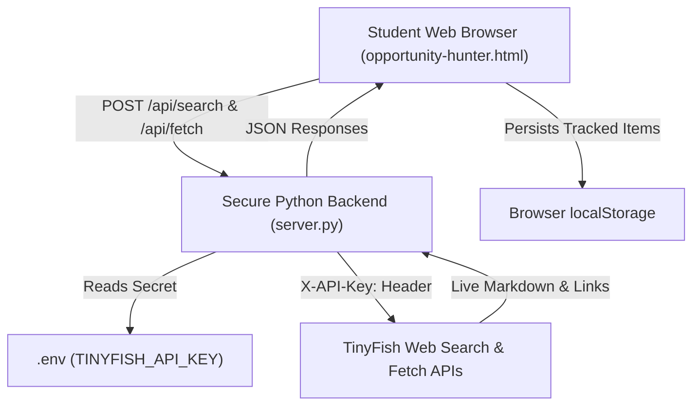

# Opportunity Hunter — Internships & Scholarships

An intelligent student opportunity discovery engine and application tracker. Finds internships, scholarships, and fellowships matched to your student profile, study year, and technical skills with transparent eligibility audits.

---

## Quick Start Guide

### 1. Requirements
* **Python 3.8+** (Python 3.14 is already installed on your system).
* Any modern web browser (Chrome, Edge, Firefox, Safari).
* **No external npm/pip dependencies required** for basic operation. Python's standard library and pre-installed `requests` are used.

---

### 2. Configure Credentials (`.env`)
1. In the project folder, locate the `.env` file (created alongside `.env.example`).
2. Add your **TinyFish API Key**:
   ```env
   TINYFISH_API_KEY=your_actual_key_here
   PORT=5000
   ```
   * *Where to get a key*: Sign up at [agent.tinyfish.ai/api-keys](https://agent.tinyfish.ai/api-keys).
   * *Demo Mode*: If you leave `TINYFISH_API_KEY=` blank, the server runs in **Demo Mode**, serving verified program fixtures with full search, filtering, radar, and Kanban features ($0 credits consumed).

> [!SECURITY]
> The `.env` file is excluded in `.gitignore` so your secret API key is never committed or published.

---

### 3. Start the Backend Server
Open your terminal (PowerShell or Command Prompt) in this folder and run:
```powershell
python server.py
```
You will see:
```text
============================================================
 Opportunity Hunter Backend Proxy 
============================================================
[STATUS] TinyFish API Key: Configured (or NOT SET for Demo Mode)
[STATUS] Mode: LIVE (or DEMO / FIXTURE FALLBACK)

[SERVER] Running at: http://localhost:5000
[SERVER] Open your browser at: http://localhost:5000/opportunity-hunter.html
============================================================
```

---

### 4. Open the Website
Open your web browser and navigate to:
```text
http://localhost:5000/opportunity-hunter.html
```
*(Or simply `http://localhost:5000`)*

---

### 5. Running Automated Tests
Run the automated test suite in terminal:

```powershell
# Run backend endpoints and security tests
python test_backend.py

# Run verification tests for the 3 bug fixes
python test_bug_fixes.py
```

---

## Architecture & Features



* **Live Search (TinyFish Web APIs)**:
  * `https://api.search.tinyfish.ai` &rarr; Low-latency live web search for student programs.
  * `https://api.fetch.tinyfish.ai` &rarr; Full Chromium page rendering and clean markdown extraction.
* **Verified Fixtures (Fallback)**:
  * [opportunity-hunter.fixtures.json](opportunity-hunter.fixtures.json) provides offline resilience so the app remains 100% demo-ready during presentations.
* **Bug Fixes Included**:
  1. *Microsoft Explore Link Resolution*: Targeted `#explorer` search portal prioritized over unrelated senior software engineer requisitions.
  2. *Infosys InStep & Winternship*: Clearly differentiates campus placement cell programs from direct university portals like InStep.
  3. *Job Seniority Isolation*: Professional job requirements (`4+ years experience`, `Senior Software Engineer`) are stripped before academic study year inference.
