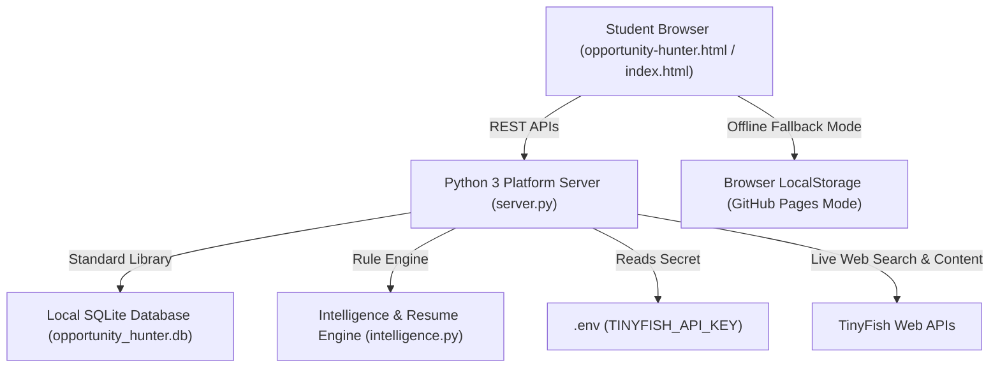

# Opportunity Hunter 2.0 — Your Personal Career & Opportunity Companion 🎯

[](https://aashi230.github.io/opportunity-hunter/)
[](#running-automated-tests)
[](#bug-fixes-included)
[](#running-automated-tests)
[](#running-automated-tests)
[](#uiux-enhancements)

> 🚀 **Live Application**: [https://aashi230.github.io/opportunity-hunter/](https://aashi230.github.io/opportunity-hunter/)

---

## 🌟 Product Vision

**Opportunity Hunter 2.0** transforms student job searching into an intelligent, transparent, and supportive career companion. It empowers college students, freshers, and undergraduates to discover verified internships, scholarships, fellowships, hackathons, and research programs—drastically cutting down the hours spent sifting through disconnected job boards.

---

## ✨ What's New in Opportunity Hunter 2.0

### 1. 📊 Executive Student Dashboard
* **Dynamic Welcome Hero**: Greets student with their major, academic study year, and track.
* **Interactive Profile Strength Gauge**: Real-time completion score (e.g. `85% Complete`) that rewards students for adding target skills and graduation year.
* **Real-time KPI Counters**:
  * 🎯 **Matching Opportunities** (programs with 75%+ fit score)
  * 📁 **Saved in Tracker** (actual count in pipeline)
  * 🚀 **Active Applications** (submitted, in assessment, or interviewing)
  * ⏳ **Critical Deadlines** (closing within 7 days)
* **Recommended Opportunities Grid**: Top personalized opportunities with instant application links.
* **Upcoming Deadlines Radar**: Real countdown badges (`Closes in 2 Days`, `Closes in 5 Days`).
* **Recent Activity Log**: Real-time pipeline events stream.

### 2. 🔍 Advanced Opportunity Discovery
* **8 Opportunity Categories**: Internships, Scholarships, Fellowships, Research Programs, Hackathons, Competitions, Training Programs, and Graduate Openings.
* **Comprehensive Filter Controls**: Filter by work mode (Remote, Hybrid, On-site), location, minimum match score, deadline urgency, and education level.
* **Circular Match Dial**: Transparent 0–100% score based on explainable factors (interest alignment, skill overlap, study year compatibility, and work mode).
* **Source Verification Badges**:
  * 🟢 **Official Verified Source** (Direct career portals, `.edu`, `.gov`, verified ATS)
  * 🟡 **Source Found, Details Unverified**
  * 🔴 **Expired**
  * ⚠️ **Needs Review** (Flags suspicious registration fee requests)

### 3. 📄 Resume Analyzer & Skill Extractor
* **Safe Local PDF & Text Processing**: Zero external data exposure; student resume data is parsed safely without leaking private info.
* **Automated Extraction**: Inferred Degree, Study Year, Graduation Year, and 80+ in-demand technical skills.
* **Resume Strength Score (0–100)**: Evaluates quantifiable metrics, action verb impact, and technical skill variety.
* **Actionable Improvement Recommendations**: Specific tips to make project bullets more competitive.
* **1-Click Profile Sync**: Automatically syncs extracted skills and degree directly into your student profile!
* **Matching Opportunities for Your Resume**: Instantly reveals opportunities tailored to your uploaded resume.

### 4. 🎯 Skill Gap Analyzer & Learning Roadmaps
* **Market Demand Frequency**: Identifies which skills are most requested across verified student programs (e.g. Python in 85% of listings, SQL in 65%, Docker in 40%).
* **Gap Analysis**: Highlights in-demand technologies missing from your profile.
* **Curated Free Roadmaps**: High-quality free guides and tutorials for Docker, SQL, Git, AWS, and Machine Learning.

### 5. 📋 Application Tracker (8-Stage Kanban Pipeline)
* **Structured Stages**:
  1. 💡 Interested
  2. 📝 Planning to Apply
  3. 📨 Applied
  4. 💻 Assessment
  5. 🤝 Interviewing
  6. 🎉 Selected
  7. ❌ Rejected
  8. ⏸️ Withdrawn
* **1-Click Stage Transitions**: Move applications across stages effortlessly.
* **Custom Applications**: Add any external opportunity with notes, deadlines, and links.
* **Export Options**: 1-click **Export to CSV (`.csv`)** for spreadsheet tracking.

### 6. ⏰ Deadline Radar & Calendar Management
* **Urgency Buckets**: `Urgent (0–3 Days)`, `Closing Soon (4–7 Days)`, `Planning Window (8+ Days)`, `Expired`.
* **Export to Calendar**: 1-click **Export to `.ics`** for Google Calendar, Apple Calendar, and Outlook.

### 7. 💬 Contextual Career Assistant
* **Grounded Guidance**: Answers student queries using their real profile and loaded opportunities with zero hallucinated links or fake dates.
* **Pre-built Prompt Chips**:
  * *"Which internships match my profile best?"*
  * *"Am I eligible for Microsoft Explore?"*
  * *"What skills should I learn next to improve my match rate?"*
  * *"How can I improve my resume for technical roles?"*
  * *"What should I prepare for an internship interview?"*

### 8. 🗄️ Backend SQLite Persistence
* Built with Python's standard `sqlite3` library (zero external npm or pip bloat).
* Tables: `profiles`, `applications`, `saved_opportunities`, `activity_log`.
* REST API endpoints:
  * `GET/POST /api/profile`
  * `GET/POST/DELETE /api/applications`
  * `GET/POST/DELETE /api/saved`
  * `GET /api/analytics`
  * `GET /api/activity`
  * `POST /api/resume/parse`
  * `POST /api/assistant`
  * `POST /api/search` & `POST /api/fetch` (TinyFish API Proxy)
  * `GET /api/fixtures` & `GET /api/status`

---

## 🏛️ Architecture & Data Flow



---

## 🚀 Quick Start Guide

### 1. Requirements
* **Python 3.8+** (Standard library only; no external pip dependencies needed).
* Any modern browser (Chrome, Edge, Firefox, Safari).

### 2. Configure Credentials (`.env`)
1. In the project folder, locate `.env` (or copy from `.env.example`).
2. Add your **TinyFish API Key**:
   ```env
   TINYFISH_API_KEY=your_actual_key_here
   PORT=5000
   ```
   * *Demo Mode*: If you leave `TINYFISH_API_KEY=` blank, the server runs in **Demo Mode**, serving verified program fixtures with full search, filtering, radar, and Kanban features ($0 credits consumed).

### 3. Start the Backend Server
```powershell
python server.py
```
Open your browser at: `http://localhost:5000` (or `http://localhost:5000/opportunity-hunter.html`).

---

## 🧪 Automated Test Suites (17/17 Passing)

Run the full automated test suite from PowerShell / Terminal:

```powershell
# 1. Run Backend Security, Endpoints & CORS Tests (7 tests)
python test_backend.py

# 2. Run Domain Verification & Bug Fix Tests (3 tests)
python test_bug_fixes.py

# 3. Run V2 Feature Tests (SQLite, Profile, Kanban, Resume, Assistant) (7 tests)
python test_v2_features.py
```

All 17 tests run in under 0.3 seconds without requiring external network dependencies.

---

## 🌐 Deployment to GitHub Pages

Opportunity Hunter 2.0 is designed with dual-mode execution:
1. **Connected Mode**: When running with `server.py`, it automatically syncs with the SQLite database and proxy.
2. **Static GitHub Pages Mode**: When hosted on GitHub Pages (`https://aashi230.github.io/opportunity-hunter/`), it automatically switches to client-side mode with LocalStorage persistence and embedded verified fixtures, ensuring **zero console errors and 100% uptime**.

GitHub Actions workflow (`.github/workflows/pages.yml`) deploys the repository directly on push to `main`.
