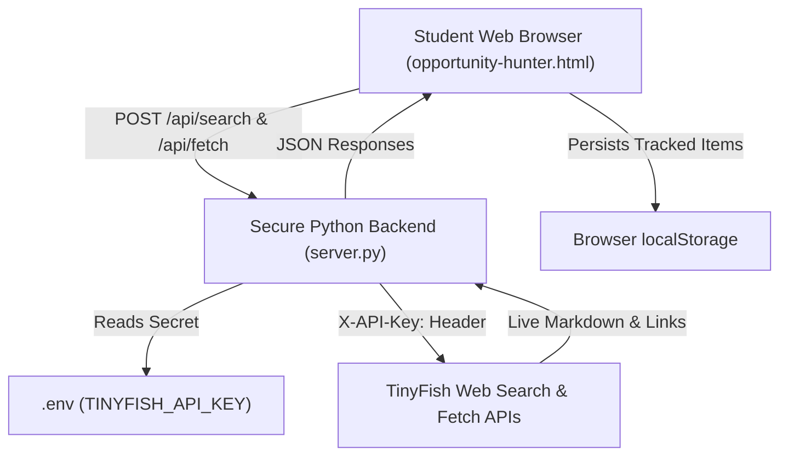

# Opportunity Hunter — Internships, Scholarships & Programs 🎯

An intelligent student opportunity discovery engine and application tracker with transparent eligibility audits, verified page extraction, and an intuitive modern interface.

[](#running-automated-tests)
[](#bug-fixes-included)
[](#uiux-enhancements)

---

## ✨ UI/UX Enhancements (v2.0)

* **Modern Design System & Typography**: Rebuilt with Google’s *Plus Jakarta Sans* font, modern frosted glassmorphism (`backdrop-filter: blur(16px)`), luminous focus states, and responsive layout across desktops, tablets, and phones.
* **Dual Theme Engine**: Seamless switch between deep dark mode (`Midnight Slate`) and soft light mode (`Clean Frost`) with preference persistence in `localStorage`.
* **Live Connection Status Pill**: Real-time indicator in the navigation bar displays whether the app is running with the **Live TinyFish API proxy** or the **Verified Offline Fixture Engine**.
* **Student Profile Hub**:
  * Real-time **Profile Completion Meter** (e.g. `85% Complete`) that rewards students for completing their degree and skills.
  * One-click **Quick Skill Tags** (`+ Python`, `+ React`, `+ SQL`, `+ Machine Learning`, etc.) for fast profile building.
  * Collapsible profile summary bar displaying student avatar, study year, and location.
* **Skeleton Shimmer Loading**: Displays smooth animated skeleton card states during search fetches instead of empty loaders.
* **Instant Filter & Search**: Debounced client-side filtering by keywords, opportunity types, work modes, and closing deadlines.
* **Interactive Opportunity Cards**:
  * Glowing match score badges with color-coded gradients (90%+ Emerald, 75%+ Indigo, <75% Amber).
  * Clear data source origin (`🌐 Live TinyFish Result` vs `📁 Verified Fixture`).
  * Deep-dive accordion with **Eligibility Audits**, **Skill Gap Roadmap**, and **Source Transparency**.
  * 1-click **Share / Copy Link** button with floating toast notification.
* **Deadline Radar & Calendar Export**:
  * Urgency-based columns (`0–3 Days`, `4–7 Days`, `8+ Days`, `Expired`).
  * Export all active deadlines directly to **Google Calendar / Apple Calendar (`.ics`)**.
* **Application Kanban Pipeline**:
  * Track applications across stages: `Interested` ➔ `Planning to Apply` ➔ `Applied` ➔ `Interviewing` ➔ `Closed`.
  * **Export to CSV (`.csv`)** for spreadsheet backups.
* **Toast Notification System**: Instant feedback for copying links, tracking opportunities, and updating statuses.

---

## 🚀 Quick Start Guide

### 1. Requirements
* **Python 3.8+** (Uses Python's standard library; no external npm/pip dependencies required).
* Any modern web browser (Chrome, Edge, Firefox, Safari).

---

### 2. Configure Credentials (`.env`)
1. In the project folder, locate the `.env` file (created alongside `.env.example`).
2. Add your **TinyFish API Key**:
   ```env
   TINYFISH_API_KEY=your_actual_key_here
   PORT=5000
   ```
   * *Where to get a key*: Sign up at [agent.tinyfish.ai/api-keys](https://agent.tinyfish.ai/api-keys).
   * *Demo Mode*: If you leave `TINYFISH_API_KEY=` blank, the server runs in **Demo Mode**, serving verified program fixtures with full search, filtering, radar, and Kanban features ($0 credits consumed).

> [!SECURITY]
> The `.env` file is excluded in `.gitignore` so your secret API key is never committed or published.

---

### 3. Start the Backend Server
Open your terminal (PowerShell or Command Prompt) in this folder and run:
```powershell
python server.py
```
You will see:
```text
============================================================
 Opportunity Hunter Backend Proxy 
============================================================
[STATUS] TinyFish API Key: Configured (or NOT SET for Demo Mode)
[STATUS] Mode: LIVE (or DEMO / FIXTURE FALLBACK)

[SERVER] Running at: http://localhost:5000
[SERVER] Open your browser at: http://localhost:5000/opportunity-hunter.html
============================================================
```

---

### 4. Open the Website
Open your web browser and navigate to:
```text
http://localhost:5000/opportunity-hunter.html
```
*(Or simply `http://localhost:5000`)*

---

### 5. Running Automated Tests
Run the automated test suite in terminal:

```powershell
# Run backend endpoints and security tests (7 tests)
python test_backend.py

# Run verification tests for the 3 bug fixes (3 tests)
python test_bug_fixes.py
```

---

## 🏛️ Architecture & Data Flow



* **Live Search (TinyFish Web APIs)**:
  * `https://api.search.tinyfish.ai` &rarr; Low-latency live web search for student programs.
  * `https://api.fetch.tinyfish.ai` &rarr; Full Chromium page rendering and clean markdown extraction.
* **Verified Fixtures (Fallback)**:
  * [opportunity-hunter.fixtures.json](opportunity-hunter.fixtures.json) provides offline resilience so the app remains 100% demo-ready during presentations.
* **Bug Fixes Included**:
  1. *Microsoft Explore Link Resolution*: Targeted `#explorer` search portal prioritized over unrelated senior software engineer requisitions.
  2. *Infosys InStep & Winternship*: Clearly differentiates campus placement cell programs from direct university portals like InStep.
  3. *Job Seniority Isolation*: Professional job requirements (`4+ years experience`, `Senior Software Engineer`) are stripped before academic study year inference.
